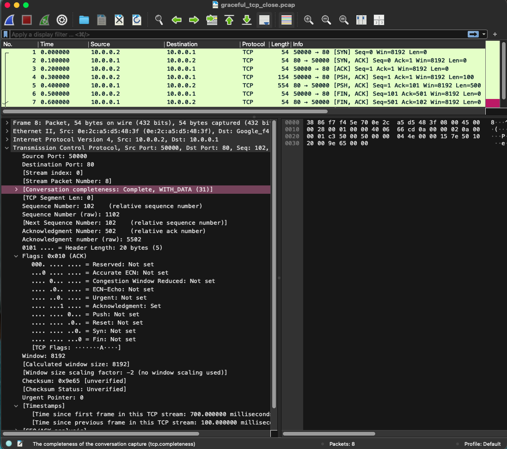
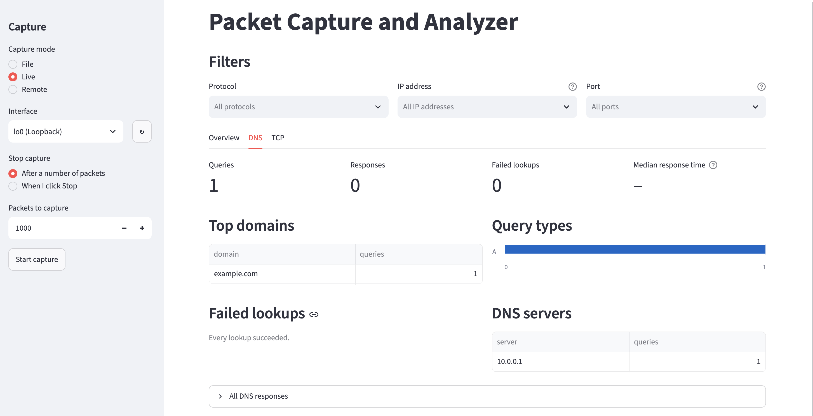

The penultimate week...

## Highlights

- Created and tested network traffic using Scapy and tshark
- Verified traffic in Wireshark
- Implemented loopback testing for DNS requests
- Began handling malformed packets
- Started writing README for networking concepts

## The Long Story

I created traffic in Scapy that wrote out to .pcap files and compared the output in the terminal using tshark and in Wireshark. In my four .pcap files, I tested TCP (successful handshake and closed connection), a DNS request, an ARP request, and HTTP GET/POST. All comparisons matched, including the HTTP POST message, which I could read because it is not encrypted. I'd like to test HTTPS as well, but this is a more involved process to encrypt using TLS and Scapy that time is not permitting. Here's a screenshot of a TCP connection created as a test to be read in Wireshark.

Loopback is working, I can see my DNS request to example.com.

The IP address ::1 is interesting looking, isn't it? It's IPv6 for the loopback address using colon notation because 0000:0000:0000:0000:0000:0000:0000:0001 is more difficult to read (and type out, too). It's more commonly known as localhost. The loopback address is for sending traffic to oneself to test the traffic. This makes sure everything is working properly. It's like practicing a speech in front of the mirror before giving it to the world.

A DNS request captured on the loopback.

I've been working on handling malformed packets with truncated headers where flags have been cut off so they aren't counted like properly formatted packets. I've made some progress on this, but will widen the net in the future. Add it to the TODO list.

I'm working on a README explaining networking concepts in my repo. My goal is to strike a tone that makes it relatable without getting into glib territory. This is probably one of the more enjoyable parts of this project so far. I enjoy writing, so hopefully that comes through!

Next week I'm putting a bow on what I've been working on with a demonstration of how it all works. This project is far from finished, as I feel like there's plenty to improve on, but I do want to celebrate how far it's come with a walk-through. It's been a great experience in supporting my Network+ studies.

It's not holding me up from a demo, but I have several TODOs I'd like to clean up, like handling more cases of malformed packets and testing for more protocols more thoroughly, just to name a couple.
